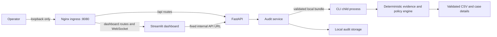

# Ghost Data Audit Agent

A local-first Python application for reconstructing deletion state from request records, identity history, activity, and supplied evidence. The deterministic engine preserves conservative identity links, the strict `audit_at` cutoff, policy distinctions, evidence provenance, and stable step order. Evidence processing makes no hosted-model or network calls. This portfolio prototype is not certified and is not suitable for arbitrary public deployment.

## Problem and approach

Deletion workflows can report success while copies remain in downstream systems or a synchronization/restore process can recreate them. Ghost Data Audit assembles the supplied identity, activity, policy, and evidence records, reconstructs each resource as of the audit cutoff, and explains the resulting state with attributable findings and ordered actions. It does not treat workflow status as proof.



The engine is explainable and deterministic: it keeps evidence provenance, resolves supported current and historical identifiers, applies policy, and orders steps consistently. Optional local screenshot OCR uses Pillow, `pytesseract`, and the separately installed Tesseract executable; it makes no network request. The repository includes only a synthetic demo bundle.

## Features and interfaces

- CLI: run an audit and validate its output.
- API: validate bundles, run audits, browse cases, preview manifest-linked evidence, download results, and delete stored audits.
- Dashboard: upload synthetic or authorized local bundles, inspect status counts and case steps, and review cases whose evidence does not support a safe plan.
- Docker Compose: loopback-only Nginx ingress, isolated internal app network, non-root containers, and bounded local retention.

## Install

Python 3.10 or newer is required. The core CLI has no mandatory third-party dependencies. Optional PDF extraction uses `pypdf`. Optional screenshot OCR uses Pillow and `pytesseract`, plus a separately installed local Tesseract executable. Installing the Python package does not install the executable. Set `TESSERACT_CMD` if it is outside PATH. OCR is bounded, local, and skipped gracefully when unavailable.

Windows PowerShell:

```powershell
py -3.10 -m venv .venv
.\.venv\Scripts\Activate.ps1
python -m pip install -e ".[app,test,pdf,ocr]"
```

macOS/Linux:

```bash
python3 -m venv .venv
source .venv/bin/activate
python -m pip install -e '.[app,test,pdf,ocr]'
```

## Synthetic CLI demo

The sample uses invented data under `examples/synthetic/`; it does not contain challenge or customer data.

```text
ghost-audit run --requests examples/synthetic/bundle/requests.csv --evidence-dir examples/synthetic/bundle --output build/demo_output.csv
ghost-audit validate --requests examples/synthetic/bundle/requests.csv --output build/demo_output.csv
```

## Local API and dashboard

Development defaults are intended for one local user. Start the API on loopback:

```text
uvicorn ghost_audit.api:create_app --factory --host 127.0.0.1 --port 8000
```

In a second terminal:

```text
streamlit run src/ghost_audit/dashboard.py --server.address 127.0.0.1 --server.port 8501
```

The API runs without authentication only in local development when no token is configured. Set `GHOST_AUDIT_BEARER_TOKEN` to enable bearer authentication; production mode always requires a valid token. Generate a token in a trusted local shell and store it in an OS secret manager or deployment secret store, not source control or a URL:

```powershell
$env:GHOST_AUDIT_MODE = "production"
$env:GHOST_AUDIT_BEARER_TOKEN = (python -c "import secrets; print(secrets.token_urlsafe(48))")
```

Configure the same token in the dashboard password field when prompted. The dashboard keeps it only in the browser session and sends it in the `Authorization: Bearer` header. The service never returns or logs the token. A shared token is not identity management, role-based access control, multi-tenant authorization, or a complete authentication system.

Security settings:

| Variable | Default | Purpose |
|---|---:|---|
| `GHOST_AUDIT_MODE` | `development` | `development` or `production`; production requires auth |
| `GHOST_AUDIT_BEARER_TOKEN` | unset | Secret bearer token, minimum 32 non-whitespace characters |
| `GHOST_AUDIT_AUTH_REQUIRED` | unset | Optional explicit auth requirement |
| `GHOST_AUDIT_CORS_ORIGINS` | empty | Comma-separated explicit HTTP(S) origins; wildcard is rejected |
| `GHOST_AUDIT_API_URL` | `http://api:8000` in Compose | Dashboard server-side URL for the internal API service |
| `GHOST_AUDIT_DATA_DIR` | OS application data directory | Audit storage root |
| `GHOST_AUDIT_MAX_UPLOAD_BYTES` | 50 MiB | Per-upload byte limit |
| `GHOST_AUDIT_MAX_ZIP_ENTRIES` | 5000 | Maximum archive entry count |
| `GHOST_AUDIT_MAX_UNCOMPRESSED_BYTES` | 250 MiB | Maximum extracted archive size |
| `GHOST_AUDIT_TIMEOUT_SECONDS` | 300 | Child execution timeout |
| `GHOST_AUDIT_MAX_CONCURRENT` | 1 | Concurrent audit limit |
| `GHOST_AUDIT_RETENTION_HOURS` | 24 | Audit retention duration |

`GET /api/health` and `/api/version` are minimal and public. Authentication protects validation, audit creation, results, cases, previews, downloads, details, and deletion. CORS is disabled unless explicit origins are configured. CORS is not an access-control substitute.

API endpoints are `GET /api/health`, `GET /api/version`, `POST /api/validate`, `POST /api/audits`, `GET /api/audits/{audit_id}`, `GET /api/audits/{audit_id}/cases`, `GET /api/audits/{audit_id}/cases/{case_id}`, `GET /api/audits/{audit_id}/evidence/{evidence_id}/preview`, `GET /api/audits/{audit_id}/download`, `GET /api/audits/{audit_id}/detail.json`, and `DELETE /api/audits/{audit_id}`. Every route except health and version requires a bearer token when authentication is enabled.

The dashboard makes server-to-server API requests. Compose uses the fixed `http://api:8000` service origin on `app_internal` and marks that connection as internal; the browser enters through the separate loopback-only `http://127.0.0.1:8080/` proxy. Loopback API addresses are treated as local. Other non-loopback API origins continue to show a warning; the marker does not bypass API authentication.

The synthetic API upload requires request CSV and a ZIP containing root `evidence_files.csv`, `user_identities.csv`, `user_audit_log.csv`, `system_activity.csv`, and `deletion_rules.csv`, plus all manifest-listed evidence paths. Example:

```powershell
New-Item -ItemType Directory -Force build | Out-Null
Compress-Archive -Path examples/synthetic/bundle/* -DestinationPath build/synthetic_bundle.zip -Force
curl.exe -F "request_csv=@examples/synthetic/bundle/requests.csv" -F "evidence_bundle=@build/synthetic_bundle.zip" http://127.0.0.1:8000/api/validate
```

For protected mode, send the bearer token in an HTTP `Authorization` header. Never put it in query parameters. Use `/api/validate`, then `POST /api/audits`; view results with `/api/audits/{audit_id}` and related routes. The dashboard provides these operations and safe text previews.

## Container deployment

Docker and Docker Compose are required. The application image installs the pinned runtime dependency set in `requirements-container.lock`, includes and verifies local Tesseract, and runs as non-root UID/GID 10001. Nginx is pinned to the official `1.30.5-alpine` image digest and runs as UID/GID 101. The app containers use read-only roots, explicit temporary storage, and a named `/data` volume. The app build excludes examples, tests, docs, datasets, outputs, logs, traces, caches, and local files. Compose mounts only the synthetic demo bundle read-only at runtime. FastAPI and Streamlit attach only to `app_internal` (`internal: true`); Nginx uses fixed upstreams and attaches to `app_internal` plus the `ingress` bridge. Only Nginx publishes a host port, bound to `127.0.0.1:8080`. The API and dashboard have no direct host ports.

```powershell
Copy-Item .env.example .env
# Keep this local demo in development mode. For production, configure secrets externally.
docker compose build
docker compose up -d
docker compose ps
```

Open the dashboard at `http://127.0.0.1:8080/`. The same local entry point routes `/api/...` to FastAPI, for example `http://127.0.0.1:8080/api/health` and `http://127.0.0.1:8080/api/version`. Create a synthetic bundle ZIP and send it to `http://127.0.0.1:8080/api/validate` or `POST http://127.0.0.1:8080/api/audits`; use the bearer Authorization header in production mode. Alternatively run the container CLI against its read-only `/demo` mount:

```powershell
docker compose exec api ghost-audit run --requests /demo/requests.csv --evidence-dir /demo --output /tmp/ghost-audit-tmp/demo.csv
docker compose exec api ghost-audit validate --requests /demo/requests.csv --output /tmp/ghost-audit-tmp/demo.csv
docker compose down
```

The included Nginx proxy is the only published service and listens on host loopback at port 8080. It routes only `/api/` to FastAPI and other paths to Streamlit; it is not a forward proxy. Loopback binding is intended for local development and is not a complete public-deployment security solution. Do not change the binding for remote access without TLS termination, protected secret management, network restrictions, and an independent deployment review. The shared bearer token remains single-user authentication only. The app does not have encrypted storage, hard memory isolation, malware scanning, or durable background jobs.

## Tests and CI

```text
python -m unittest discover -s tests -v
```

GitHub Actions tests Python 3.10–3.13, runs the synthetic CLI and tests, verifies imports and wheel packaging, builds the image, runs a synthetic CLI inside a network-disabled container, and validates Compose configuration. It does not scan for vulnerabilities or certify security. The workflow has not yet been run on GitHub.

### Synthetic dashboard screenshot

Start Compose using the commands above, open `http://127.0.0.1:8080/`, and upload `examples/synthetic/bundle/requests.csv` plus the `build/synthetic_bundle.zip` created by the `Compress-Archive` command above. Select **Validate inputs**, then **Run local audit**. The dashboard shows only invented demo identities and records. Capture a screenshot from the browser after the results appear; keep it out of the repository unless it has been reviewed for private browser or machine details. Stop the services with `docker compose down`.

### Roadmap

- Add owner-scoped authentication and authorization before multi-user use.
- Move long audits to durable background jobs with explicit CPU and memory limits.
- Add independent review of evidence attribution and policy outcomes.
- Add vulnerability scanning, external security review, encrypted storage, and recovery testing before considering a real deployment.

## Retention and limitations

Request and evidence inputs, results, and output are retained in the local audit directory for 24 hours by default. Expired data is removed at startup and on API access; users can delete an audit earlier. This is ordinary filesystem deletion, not secure erasure. Storage is not encrypted at rest and external copies or backups are not removed. POSIX directory permissions are restricted where supported.

The service validates upload sizes, archive entries, paths, symlinks, extensions, manifest references, and timestamps; isolates audits by random IDs; limits concurrency and execution time; terminates child process trees on timeout; validates output before success; and removes failed inputs and partial outputs. This is not an OS sandbox against a hostile local user and does not impose a verified memory limit. The synchronous API can occupy a request worker until timeout. A durable job service is not implemented.

For source architecture and remaining risks, see [`docs/architecture.md`](docs/architecture.md) and [`docs/security-and-privacy.md`](docs/security-and-privacy.md). Human review remains necessary for ambiguous or high-impact deletion decisions. An empty `INCOMPLETE` plan means evidence may be insufficient; it does not show that deletion succeeded. No independent ground-truth evaluation is included with this standalone product, so the README makes no prediction-accuracy claim.

## License and challenge materials

No `LICENSE` file is included, and no open-source license is granted by this repository. The project metadata labels the package as a proprietary portfolio project; choose and add a license only after reviewing the intended publication rights. No challenge dataset, evidence bundle, prediction output, or transcript is part of this repository. Check the edition-specific event instructions before publicly reusing challenge-derived material.

## Verification snapshot

Verified locally on 2026-10-26 with Python 3.13: 80 tests ran, 79 passed, and 1 Windows-specific POSIX process-tree test was skipped. The clean environment passed `pip check`; the synthetic CLI demo generated and validated two rows; and a fresh wheel build succeeded.

The no-cache Compose image build and `docker compose config --quiet` passed. Runtime verification also passed: all three services became healthy; API health and version returned 200; an unauthenticated sensitive route returned 401; authenticated synthetic validation and audit creation, retrieval, case listing, download, and deletion succeeded; and retrieval after deletion returned 404. The dashboard loaded at `http://127.0.0.1:8080/` without the generic external-API warning, and its Streamlit WebSocket handshake succeeded.

The only host-published port was proxy `127.0.0.1:8080`; API and dashboard had no host bindings. API and dashboard ran as UID 10001 with read-only roots, the proxy as UID 101, and the app network was internal. A local CONNECT attempt was rejected; the image application tree contained no challenge dataset, demo bundle, tests, traces, credentials, virtual environments, caches, profiling data, or archives. Runtime logs contained neither the temporary bearer token nor synthetic subject identifiers. The test containers, network, volume, and local app images were removed after verification.

The GitHub Actions workflow has not been run on GitHub. Passing these local checks does not establish remote CI behavior, production readiness, TLS, encryption, or hard resource isolation.